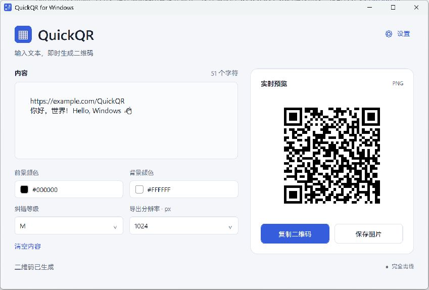
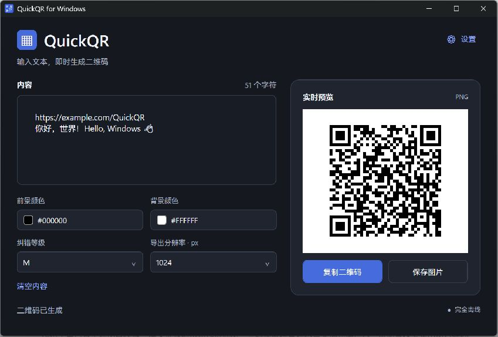
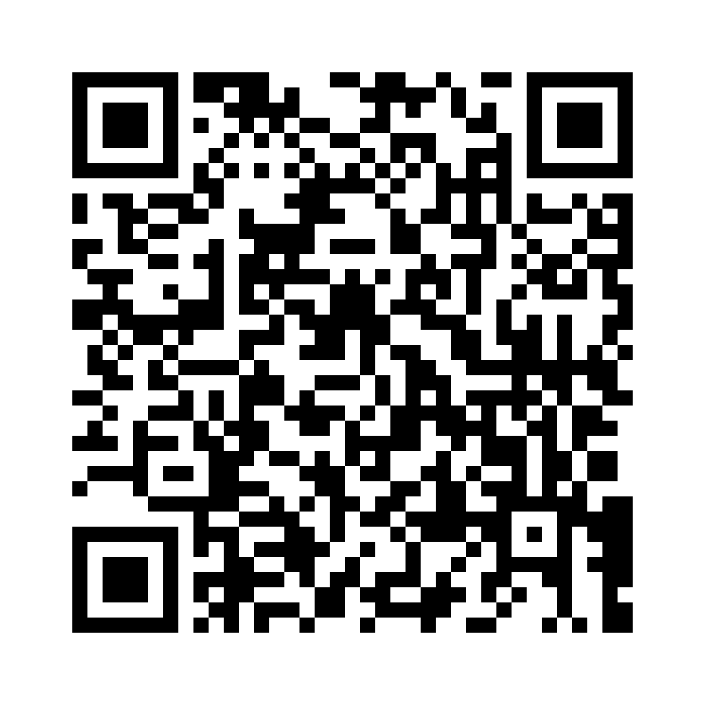

# QuickQR for Windows


[](LICENSE)

**输入文本，即时生成二维码。** 一个轻量、完全离线的 Windows 原生桌面工具，支持系统托盘快捷面板、复制图片和无损 PNG 导出。

**English:** QuickQR is an offline, native Windows QR code generator built with C# and WPF on .NET 10. Type or paste text to generate a QR code instantly, copy it as an image, export a crisp PNG, or use the system tray panel.

[下载 Releases](https://github.com/you2032zhu/QuickQR/releases) · [构建记录](https://github.com/you2032zhu/QuickQR/actions/workflows/build.yml) · [更新日志](CHANGELOG.md) · [贡献指南](CONTRIBUTING.md)

> 当前源码版本为 **1.0.0，尚未创建正式发布标签**。以上是拟发布仓库的入口，首次公开仓库和 Release 获得维护者确认后才会生效。

## 截图

以下两张来自实际运行的 WPF 窗口，使用隔离的示例宿主加载相同界面、ViewModel 和二维码服务；未读取真实用户设置或输入。

| 主窗口 · 浅色 | 主窗口 · 深色 |
|---|---|
|  |  |

| 托盘二维码面板 | PNG 导出效果 |
|---|---|
| 待补充真实截图：当前截图工具无法枚举无任务栏按钮的工具窗口 |  |

截图规范与目标文件名见 [assets/screenshots](assets/screenshots/README.md)。

## 功能

- **实时生成**：支持中文、英文、数字、URL、Emoji、特殊符号和多行文本，输入后自动更新，无需生成按钮。
- **复制二维码图片**：写入真正的 Windows 图片剪贴板，提供复制成功或失败反馈，暂时占用时重试。
- **保存 PNG**：原生保存对话框，512 / 1024 / 2048 像素正方形输出，默认 1024；直接绘制模块，保持边缘清晰和标准留白。
- **系统托盘**：左键打开或关闭快捷面板，右键显示原生菜单；关闭主窗口后继续驻留。
- **快捷面板**：输入、粘贴、清空、复制、保存，与主窗口共享同一个 ViewModel 和二维码状态。
- **主题与配色**：浅色、深色、跟随 Windows；选择前景和背景颜色，限制深色前景与浅色背景、最低 4.5:1 对比度；支持 L / M / Q / H 纠错。
- **启动设置**：标准模式或托盘优先，可选当前用户登录启动，默认关闭。
- **完全离线**：没有在线二维码 API、遥测、数据库或剪贴板监听器；自动粘贴仅在用户开启后、打开面板时读取一次。

## 系统要求

| 项目 | 要求 |
|---|---|
| 目标系统 | Windows 10 22H2 / Windows 11 |
| 架构 | x64；另提供 ARM64 交叉构建 |
| 普通用户运行 | 自包含 ZIP，无需另外安装 .NET，无需管理员权限 |
| 开发 | Windows、`global.json` 指定的 .NET 10 SDK；Visual Studio 2026 或兼容该 SDK 的开发环境 |

当前实际运行验证在 Windows x64 build 26300 完成。Windows 10、ARM64 真机、混合 DPI、多显示器和各扫码/聊天软件的完整验收仍需对应环境测试，详见 [TESTING.md](TESTING.md)。

## 下载与安装

1. 打开 [GitHub Releases](https://github.com/you2032zhu/QuickQR/releases)。首个 Release 发布前，该页面可能还没有下载文件。
2. Intel / AMD 64 位电脑下载 `QuickQR-v1.0.0-win-x64.zip`；Windows on Arm 下载对应的 `win-arm64.zip`。后续版本文件名随版本号变化。
3. **完整解压整个 ZIP**，保留 DLL、运行库和子目录，双击 `QuickQR.exe`。不要从压缩包内直接运行，或只提取 EXE。
4. 可通过 `SHA256SUMS.txt` 核对下载文件：

```powershell
Get-FileHash .\QuickQR-v1.0.0-win-x64.zip -Algorithm SHA256
```

当前稳定交付方式为文件夹 ZIP。仓库包含候选 Inno Setup 脚本，但在安装/卸载验收完成前，自动 Release 不上传安装器。正式发布文件目前未使用发布者证书签名。

## 使用教程

1. 在左侧输入或粘贴文本，右侧二维码约 140 ms 后自动更新。
2. 按需设置前景/背景颜色、纠错等级和导出尺寸。主题只影响界面，不会修改二维码颜色。
3. 点击“复制二维码”复制图片，或点击“保存图片”保存 PNG，默认名为 `QRCode.png`。
4. 清空输入时显示占位提示；内容超出当前容量时显示错误，并禁用复制与保存，避免复制旧图。

输入内容不默认保存，应用重启后不会恢复二维码文本。偏好设置保存在 `%LocalAppData%\QuickQR\settings.json`。

## 系统托盘

- 应用启动后显示托盘图标，Windows 可能将它放入“隐藏的图标”区域。
- **单击**图标切换快捷面板；面板支持输入、粘贴文本、清空、复制和保存。
- 点击面板外部或按 `Esc` 隐藏面板；原生保存对话框期间暂缓失焦隐藏。
- **右键菜单**提供“打开 QuickQR”“显示二维码面板”“设置”“退出 QuickQR”。
- 主窗口右上角 X 只隐藏窗口。要完全结束进程，请从托盘选择“退出 QuickQR”。
- 开启托盘优先模式后，下次启动只显示托盘图标；登录启动也遵循所选模式。

登录启动只修改当前用户 Run 项，不要求管理员权限。请先将程序放到固定目录；移动程序后，在新位置重新关闭并开启该选项以更新路径。

## 快捷键

| 快捷键 | 作用 |
|---|---|
| `Ctrl+Shift+C` | 复制当前二维码图片 |
| `Ctrl+S` | 保存当前二维码 |
| `Ctrl+L` | 聚焦文本输入框 |
| `Esc` | 隐藏托盘面板 |

快捷键仅在对应窗口获得焦点时生效。未注册全局快捷键，文本框原有的 `Ctrl+C`、`Ctrl+V`、`Ctrl+A` 保留。

## 技术栈与结构

C# · .NET 10 · WPF · MVVM · ZXing.Net 0.16.11 · Windows Clipboard · NotifyIcon。

只有 ZXing.Net 一个第三方运行依赖。MVVM 基础类在项目内实现，无 Electron、WebView 或网页套壳。二维码使用 UTF-8 / ECI、默认 M 纠错、四模块 Quiet Zone；预览和导出复用同一模块绘制逻辑。

保留现有清晰目录，避免仅为排版移动源码：

```text
QuickQR/
├── .github/workflows/       # Windows CI 与标签发布
├── QuickQR.Windows/        # WPF 应用、MVVM 与服务
├── QuickQR.Tests/          # STA 自动测试与可选桌面测试
├── assets/screenshots/     # 真实截图
├── scripts/                # 构建、打包、候选安装器
├── packaging/              # Inno Setup 源码
├── licenses/               # 第三方许可证
├── Directory.Build.props   # 统一版本
├── global.json             # SDK 版本
├── LICENSE
└── QuickQR.sln
```

## 本地编译和测试

安装 `global.json` 指定的 .NET 10 SDK，或同一 SDK feature band 的兼容补丁版本；使用 PowerShell 7。在仓库根目录执行：

```powershell
pwsh ./scripts/Build.ps1
dotnet run --project QuickQR.Windows -c Release --no-build
# 在可交互 Windows 桌面上，额外验证剪贴板与真实窗口：
pwsh ./scripts/Build.ps1 -Interactive
```

构建脚本使用锁定依赖、Release 编译、警告视为错误，并检查每个原生命令退出码。测试是可执行的 STA 宿主，**不使用 `dotnet test`**。交互测试会短暂显示测试窗口，并将合成测试图片写入剪贴板；不更改实际登录启动项。

首次恢复构建依赖需要网络，发布后的应用离线运行。WPF 不能在 macOS 或 Linux 直接运行。Visual Studio 2022 不属于 .NET 10 的官方支持组合，见 [微软环境说明](https://learn.microsoft.com/en-us/dotnet/core/install/windows)。

## 自动构建与发布

- `build.yml`：main 推送、Pull Request 和手动运行；Windows Runner 安装固定 SDK、还原、Release 构建、运行非交互测试，上传 x64 构建产物。
- `release.yml`：推送 `v*` 标签时，检查语义版本与源码版本一致，构建并测试，发布 x64 / ARM64 自包含 ZIP，验证每个压缩文件的内容、PE 架构和 GUI 子系统，生成 SHA256，再创建 GitHub Release。
- 官方 Actions 固定到提交 SHA，Dependabot 定期提出升级。只有最终创建 Release 的任务拥有 `contents: write`。

```powershell
# 本地生成候选 ZIP 与发布说明；不会创建 Git 标签或 GitHub Release：
pwsh ./scripts/Package.ps1 -Tag v1.0.0
```

产物位于 `artifacts/release/`，详见 [PUBLISHING.md](PUBLISHING.md)。首次正式发布前需要维护者确认；本地验证不代表 GitHub 托管工作流已经实际运行。

## 常见问题

**关闭主窗口后为什么还在运行？** 这是托盘工具的预期行为。从托盘菜单退出可完全结束程序。

**看不到托盘图标？** 检查任务栏隐藏图标区域。托盘优先模式启动时不会显示主窗口。

**复制或粘贴失败？** 其他应用可能暂时占用剪贴板；程序会重试并提示。请稍后重试，或保存 PNG。原生图片格式已测试，各个聊天/Office 客户端仍需对应版本验收。

**内容过长？** QR 容量取决于文本编码和纠错等级。缩短内容或降低纠错等级，不会自动裁剪输入。

**为什么发布包体积比程序源码大很多？** 自包含包附带 .NET 和 WPF 运行库，使用户不必额外安装运行时。

**设置损坏怎么办？** 程序会备份损坏文件、恢复默认值并提示。二维码文本和剪贴板内容不写入设置。

**如何更新或卸载？** 从托盘退出后替换/删除整个程序目录。删除前先关闭登录启动；如需清除偏好，可自行删除 `%LocalAppData%\QuickQR`。卸载不会主动删除用户设置或导出的图片。

## 贡献、许可证与版本

欢迎 Issue 和 PR，参见 [CONTRIBUTING.md](CONTRIBUTING.md)。本项目使用 [MIT License](LICENSE)，署名 `you2032zhu`；ZXing.Net 保持 Apache-2.0，.NET / Windows Desktop 的声明继续保留，见 [THIRD-PARTY-NOTICES.md](THIRD-PARTY-NOTICES.md)。

版本集中在 `Directory.Build.props`，遵循 SemVer：修复递增补丁版本、兼容新功能递增次版本、破坏性修改递增主版本。当前为 **1.0.0 候选版本**，正式版本以经维护者批准的标签和 Release 为准。
